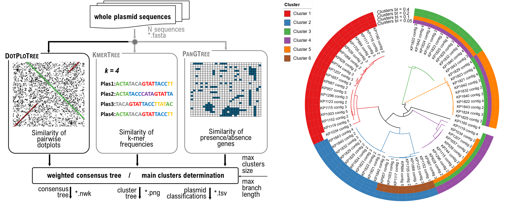

# PlasTree

A tree-based pipeline for clustering complete bacterial plasmids from long-read assemblies, combining structural, k-mer, and gene-content similarity into a single weighted consensus tree.



## Overview

PlasTree integrates three complementary similarity methods, DotPloTree (pairwise dotplot-based structural similarity), KmerTree (ranked k-mer frequency similarity), and PanGTree (pangenome presence/absence similarity), and combines them into a single weighted consensus tree. Plasmids are then automatically grouped into clusters based on branch length and cluster size thresholds. PlasTree is intended for complete plasmid assemblies from long-read sequencing (e.g. Oxford Nanopore Technologies), where rearrangements, recombination, and accessory gene turnover can obscure relationships found by a single similarity measure.

## Content

- [Key Features](#key-features)
- [Requirements](#requirements)
- [Installation](#installation)
- [Usage](#usage)
  - [Parameters](#parameters)
  - [Example](#example)
  - [Output](#output)
- [Generating pangenome input (Bakta + Roary/Panaroo)](#generating-pangenome-input-bakta--roarypanaroo)
- [License](#license)
- [Citation](#citation)
- [Contact](#contact)

## Key Features

- **Three independent tree-building methods**: DotPloTree (structural), KmerTree (nucleotide composition), and PanGTree (gene content, Roary or Panaroo format)
- **Weighted consensus tree** (3:2:1 DotPloTree:PanGTree:KmerTree) when two or more methods are combined
- **Automatic clustering** of plasmids by branch length, with support for multiple thresholds computed in a single run
- **Installable as a standard Python package**, exposing a single `plastree` command
- Optional PNG rendering of pairwise dotplots and the final cluster-colored consensus tree

## Requirements

- Python 3.10+
- All other dependencies (Biopython, NumPy, Pandas, SciPy, Matplotlib) are installed automatically with the package.

## Installation

First create an isolated environment named `plastree` (pick one option below), then install PlasTree into it.

**Option A: venv**
```bash
python3 -m venv plastree
source plastree/bin/activate
pip install --upgrade pip
```

**Option B: conda / miniforge**
```bash
conda create -n plastree python=3.12
conda activate plastree
```

With the environment active, install PlasTree directly from GitHub:
```bash
pip install git+https://github.com/BioSys-BUT/PlasTree.git
```

Or, if you want a local copy of the source:
```bash
git clone https://github.com/BioSys-BUT/PlasTree.git
cd PlasTree
pip install .
```

Verify the install:
```bash
plastree --help
```

## Usage

```bash
plastree --fasta <fasta_path> [--pang_format {roary,panaroo}] [--pang_csv <csv_path>] [--methods dotplot kmer pang] [--outdir <out_dir>] [--max_cluster_size <int>] [--max_branch_length <float> [<float> ...]] [--dotplot_window {19,22}] [--dotplot_threads <int>] [--dotplot_png] [--result_tree_png]
```

### Parameters

- `--fasta`: Path to input FASTA file with plasmid sequences. **Required.**
- `--pang_format {roary,panaroo}`: Format of the pangenome CSV. Required when using `--methods pang`.
- `--pang_csv`: Path to the pangenome presence/absence CSV file. Required when using `--methods pang`.
- `--methods [dotplot pang kmer ...]`: Tree construction methods to apply. Default: `dotplot` only.
- `--outdir`: Directory to store output files. Default: `output`.
- `--max_cluster_size`: Maximum OTUs (plasmids) per cluster. Default: half the number of input sequences.
- `--max_branch_length`: Maximum allowed branch length within a cluster (0-1). Accepts one or more values (e.g. `0.1 0.2 0.05`); one cluster-assignment table is produced per value. Default: `0.2`.
- `--dotplot_window {19,22}`: Sliding window size for dotplot comparison. Default: `22`.
- `--dotplot_threads`: Number of parallel worker processes for dotplot pairwise distance computation. Default: `1`.
- `--dotplot_png`: Save pairwise dotplots as PNGs. Only for <=20 sequences. Default: off.
- `--result_tree_png`: Save the consensus tree as a PNG with node support and cluster coloring. Default: off.

### Example

```bash
plastree \
  --fasta sequences.fasta \
  --methods dotplot kmer pang \
  --pang_format panaroo \
  --pang_csv gene_presence_absence.csv \
  --dotplot_window 22 \
  --dotplot_threads 8 \
  --max_cluster_size 30 \
  --max_branch_length 0.05 0.1 0.2 0.4 \
  --result_tree_png \
  --outdir output
```

with example data (8 small real plasmids from *Enterococcus faecium*, included in [`examples/`](examples)):
```bash
plastree \
  --fasta examples/plasmids.fasta \
  --methods dotplot kmer pang \
  --pang_format panaroo \
  --pang_csv examples/gene_presence_absence.csv \
  --result_tree_png \
  --outdir examples/output
```

### Output

All output files are written to `--outdir`.

| File | Description |
|---|---|
| `dotplot_tree.newick`, `kmer_tree.newick`, `pang_tree.newick` | tree from each selected method |
| `*_distmat.tsv` | corresponding distance matrix |
| `consensus_tree.newick` | weighted consensus tree (only when 2+ methods are used) |
| `plasmid_clusters.tsv` (or `plasmid_clusters_bl<value>.tsv` per threshold when multiple `--max_branch_length` values are given) | cluster assignment per plasmid (cluster 0 = outlier) |
| `cluster_tree.png` (or `cluster_tree_<value>.png` per threshold; only with `--result_tree_png`) | consensus tree rendered with clusters color-coded |

## Generating pangenome input (Bakta + Roary/Panaroo)

The `--pang_csv` file used by `--methods pang` is not produced by PlasTree itself. It comes from annotating the same plasmid FASTA files and clustering the predicted genes into orthologous groups, using external tools.

1. Annotate each plasmid with [Bakta](https://github.com/oschwengers/bakta) (one GFF3 file per plasmid):
```bash
for fasta in *.fasta; do
    sample=$(basename "$fasta" .fasta)
    bakta --db /path/to/bakta/db --threads 16 --output "${sample}_bakta" --skip-sorf "$fasta"
done
```

2. Collect all resulting GFF3 files into one directory:
```bash
mkdir -p all_gff3
find . -mindepth 2 -name '*.gff3' -exec cp {} all_gff3/ \;
cd all_gff3
```

3. Run [Roary](https://sanger-pathogens.github.io/Roary/) and/or [Panaroo](https://github.com/gtonkinhill/panaroo) on the collected GFF3 files:
```bash
# Roary
roary *.gff3 -t 4

# Panaroo
panaroo -i *.gff3 -o panaroo_out --clean-mode sensitive -t 16
```

Both produce a `gene_presence_absence.csv` (Panaroo additionally writes a Roary-compatible `gene_presence_absence_roary.csv`). Pass this file as `--pang_csv`, together with the matching `--pang_format roary` or `--pang_format panaroo`. Bakta, Roary, and Panaroo each have their own, sometimes conflicting, dependencies, so it is common to install them into separate environments (e.g. separate conda environments).

## License

See [LICENSE](LICENSE) for details (MIT).

## Citation

If you use PlasTree in your research, please cite:

```bibtex
@article{plastree2026,
  title={PlasTree: A Tree-Based Pipeline for Clustering Complete Plasmids from Long-Read Assemblies},
  author={Vitkova, Helena and Jakubickova, Marketa and Bezdicek, Matej and Holubova, Ema and Lengerova, Martina},
  year={2026}
}
```

## Contact

For questions and feedback, please open an issue on GitHub or contact us via email at [jakubickova@vut.cz](mailto:jakubickova@vut.cz).